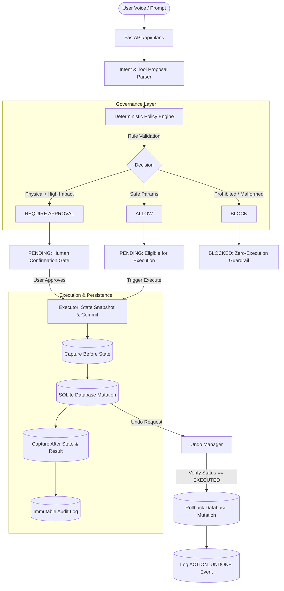

# UNDO Architecture & Governance Specification

## 1. Overview & Problem Definition

Autonomous AI agents (such as simulated Alexa+ agents) frequently need to execute operations with real-world or digital side effects: modifying household grocery lists, creating critical reminders, scheduling deliveries, or actuating physical entry doors.

Unchecked agent tool-calling presents two fatal risks:
1. **Hallucinatory execution**: The model invokes tools with malformed, excessive, or disallowed parameters based on flawed reasoning.
2. **Irreversible state corruption**: When an agent misinterprets user intent or the user changes their mind, conventional systems lack a deterministic, state-verified reversal mechanism.

**UNDO** solves this by inserting a deterministic action-governance layer between agent intent generation and execution, coupled with snapshot-backed state reversibility.

---

## 2. Core Architecture

---

## 3. Policy Engine Matrix

| Action Type | Conditions / Invariants | Policy Decision | Reason / Security Policy |
| :--- | :--- | :--- | :--- |
| `add_grocery_item` | `quantity` <= 100, `name` non-empty | **ALLOW** | Routine consumable household addition. |
| `add_grocery_item` | `quantity` > 100 | **REQUIRE_APPROVAL** | Exceeds standard household bulk threshold. |
| `add_grocery_item` | `name` empty or `quantity` <= 0 | **BLOCK** | Parameter validation failure. |
| `create_reminder` | `title` and `remind_at` non-empty | **ALLOW** | Routine notification scheduling. |
| `set_door_lock` | Known door (`front_door`, `back_door`, `garage`), valid state | **REQUIRE_APPROVAL** | Physical security entry point modification. |
| `wipe_database`, `transfer_funds`, `delete_account` | Any invocation | **BLOCK** | Prohibited high-risk capability. |
| Unknown tool name | Any invocation | **BLOCK** | Tool is not registered in system capability manifest. |

---

## 4. State Reversibility Invariants

To guarantee absolute integrity:
1. **Reversibility Flag**: Only operations with `is_reversible == True` can be rolled back.
2. **State Guard**: Only operations currently in `status == 'EXECUTED'` can be undone.
3. **Idempotency Guard**: Attempting to undo an already reversed operation (`status == 'REVERSED'`) raises an `UndoError`.
4. **Inverse Operations**:
   - `add_grocery_item`: Retrieves `item_id` from `after_state` and removes it from `simulated_groceries`.
   - `create_reminder`: Retrieves `reminder_id` from `after_state` and removes it from `simulated_reminders`.
   - `set_door_lock`: Restores `before_state.was_locked` to `simulated_doors`.
5. **Audit Logging**: Every transition (propose, approve, execute, undo, block) writes an immutable record to `audit_events`.
