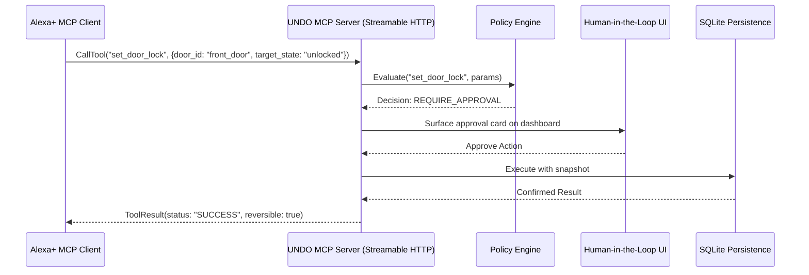

# Planned Future Integrations: AWS Bedrock & Python MCP SDK

This document specifies the integration architecture planned for upcoming milestones. In Day 1 (Foundation Implementation), these integrations are scaffolded via backend adapters (`app/integrations/bedrock_adapter.py` and `app/integrations/mcp_adapter.py`) to prevent premature dependency lock-in while ensuring seamless pluggability.

---

## 1. Amazon Bedrock Integration (Planned Milestone 2)

### Target Stack:
- **SDK**: `boto3>=1.35.0`
- **Model**: `anthropic.claude-3-5-sonnet-20241022-v2:0` (via Bedrock Converse API)
- **Role in UNDO**: Natural language intent interpretation and structured tool proposal generation.

### Architecture & Security Separation:

```mermaid
flowchart LR
    UserPrompt[User Natural Language Prompt] --> BedrockConverse[Amazon Bedrock Converse API]
    BedrockConverse -->|Tool Use Proposal| IntentParser[UNDO ActionIntentParser]
    IntentParser --> PolicyEngine[Deterministic Policy Engine]
    
    style PolicyEngine fill:#1e1b4b,stroke:#8b5cf6,stroke-width:2px;
```

**Critical Security Rule**:
Bedrock produces *proposals only*. It **never** receives credentials to directly execute actions. All proposals pass through UNDO's deterministic Policy Engine (`ALLOW`, `REQUIRE_APPROVAL`, `BLOCK`) before any database or device side effects occur.

---

## 2. Official Python MCP SDK with Streamable HTTP (Planned Milestone 3)

### Target Stack:
- **SDK**: `mcp[cli]>=1.0.0`
- **Transport**: Streamable HTTP (`/mcp/sse` and `/mcp/messages`)
- **Port**: `8001` (configurable via `MCP_SERVER_PORT`)

### Exposed MCP Tools:
1. `add_grocery_item` (Reversible, Policy: ALLOW or REQUIRE_APPROVAL for bulk)
2. `create_reminder` (Reversible, Policy: ALLOW)
3. `set_door_lock` (Reversible, Policy: REQUIRE_APPROVAL)

### Streamable HTTP Interaction Flow:

---

## 3. Implementation Status Summary

| Integration | Milestone 1 (Current) | Milestone 2 | Milestone 3 |
| :--- | :--- | :--- | :--- |
| **Deterministic Policy Engine** | **Implemented & Tested** | Active | Active |
| **State Snapshots & Undo** | **Implemented & Tested** | Active | Active |
| **SQLite Persistence** | **Implemented & Tested** | Active | Active |
| **React + Tailwind Dashboard** | **Implemented & Tested** | Active | Active |
| **Amazon Bedrock (Boto3)** | Scaffolded Interface | Planned | Production |
| **Python MCP SDK (Streamable HTTP)** | Tool Manifest Defined | Planned | Production |
