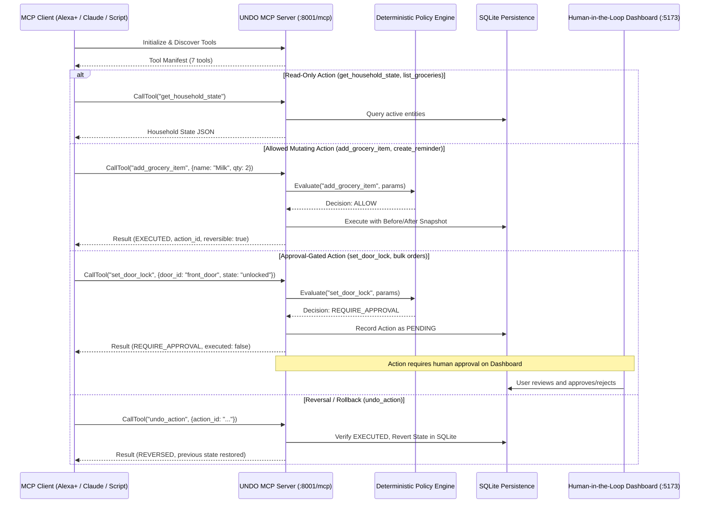

# UNDO MCP Server & Future Integrations

This document specifies the Model Context Protocol (MCP) server architecture implemented in Day 2, and the planned Amazon Bedrock Converse API integration scheduled for upcoming milestones.

---

## 1. Official Python MCP Server (Day 2 Implemented)

### Overview
UNDO implements a genuine Model Context Protocol (MCP) server utilizing the official **Python MCP SDK (`mcp>=2.3.0`)** and **Streamable HTTP transport**.

- **Transport**: Streamable HTTP
- **Default Endpoint**: `http://127.0.0.1:8001/mcp`
- **Protocol Version**: `2025-11-25`
- **Session Lifecycle**: State-managed via `StreamableHTTP session manager`

### Architecture & Security Separation

### Exposed Governed MCP Tools
| Tool Name | Parameters | Safety / Policy | Reversibility | Description |
| :--- | :--- | :--- | :--- | :--- |
| `list_groceries` | None | Read-Only | N/A | Lists all active items in the simulated grocery list. |
| `get_household_state` | None | Read-Only | N/A | Full snapshot of doors, groceries, and reminders. |
| `get_action_history` | `limit: int = 10` | Read-Only | N/A | Recent actions, policy reasons, and execution statuses. |
| `add_grocery_item` | `name: str`, `quantity: int`, `category: str` | ALLOW (or REQUIRE_APPROVAL if > 100) | **Yes** | Adds item, captures state snapshot, creates action plan. |
| `create_reminder` | `title: str`, `remind_at: str`, `priority: str` | ALLOW (valid params) | **Yes** | Schedules routine notification. |
| `set_door_lock` | `door_id: str`, `target_state: str` | **REQUIRE_APPROVAL** | **Yes** | Queues door action. Tool call cannot bypass approval. |
| `undo_action` | `action_id: str` | Governed Rollback | N/A | Reverts executed action to prior state in SQLite. |

---

## 2. Amazon Bedrock Integration (Planned Milestone)

### Target Stack:
- **SDK**: `boto3>=1.35.0`
- **Model**: `anthropic.claude-3-5-sonnet-20241022-v2:0` (via Bedrock Converse API)
- **Role in UNDO**: Natural language intent interpretation and structured tool proposal generation.

**Security Isolation Principle**:
Bedrock will act strictly as an intent parser emitting proposed tool calls. Bedrock will **never** have direct database or device credentials. All proposals pass through UNDO's authoritative Policy Engine before any state is mutated.

---

## 3. Implementation Status Summary

| Capability | Milestone 1 | Day 2 (Current) | Milestone 3 |
| :--- | :--- | :--- | :--- |
| **Deterministic Policy Engine** | Implemented & Tested | **Active & Authoritative** | Active |
| **State Snapshots & Undo** | Implemented & Tested | **Active & Authoritative** | Active |
| **SQLite Persistence** | Implemented & Tested | **Shared & Active** | Active |
| **React + Tailwind Dashboard** | Implemented & Tested | **Updated with MCP Status** | Active |
| **Official Python MCP Server** | Roadmap Scaffold | **Live Streamable HTTP (:8001)** | Production |
| **MCP Client Test Suite** | None | **6 Automated Tests Passed** | Extended |
| **Amazon Bedrock (Boto3)** | Scaffolded Interface | Scaffolded Interface | Active |
